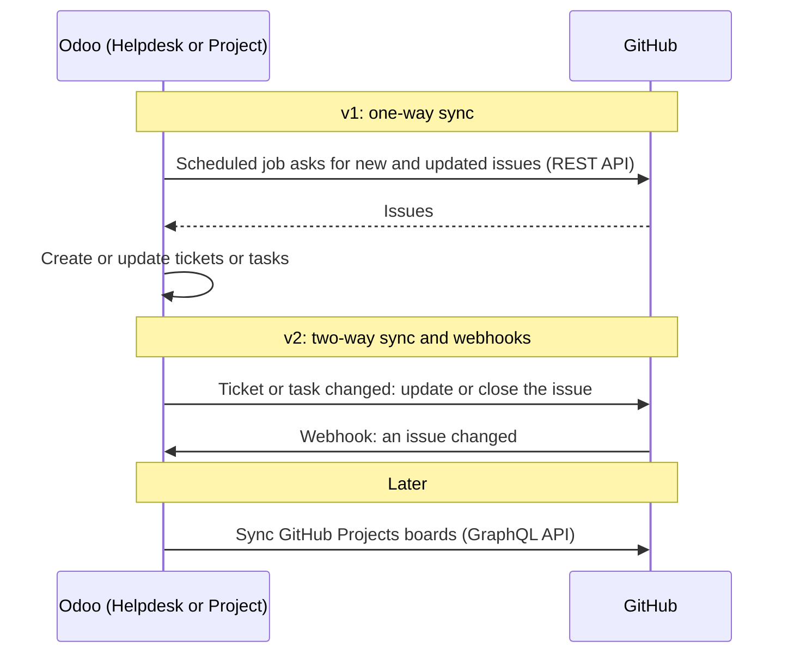

# Odoo GitHub Sync

Odoo 19.0 modules that import GitHub issues into Odoo and keep them up to
date.

| Module | What it does |
| --- | --- |
| [github_issue_sync](github_issue_sync/) | Shared base: GitHub client, access token, GitHub logins on users and the sync logic. Installed automatically with the modules below. |
| [helpdesk_mgmt_github](helpdesk_mgmt_github/) | GitHub issues become tickets of the OCA [Helpdesk Management](https://github.com/OCA/helpdesk/tree/19.0/helpdesk_mgmt) module. |
| [project_github](project_github/) | GitHub issues become project tasks. Does not need Helpdesk. |

Install `helpdesk_mgmt_github`, `project_github` or both. Each module has
its own README with the configuration and usage steps.

## How Odoo and GitHub talk

## Why a separate base module

No OCA module imports GitHub issues. OCA
[interface-github](https://github.com/OCA/interface-github) imports
organizations, teams, repositories and branches, but its Odoo 19.0 version
is not merged yet. `github_issue_sync` is kept small so that it can later
be built on OCA `github_connector` instead.

## License

[AGPL-3.0 or later](LICENSE).
