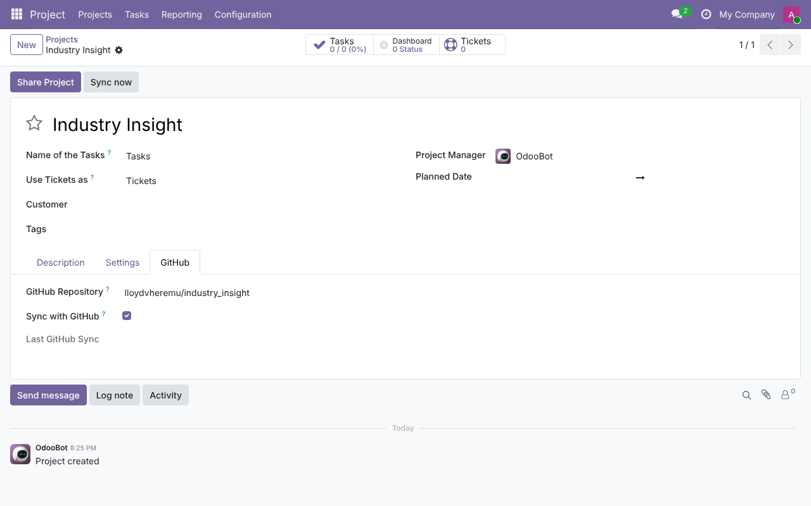
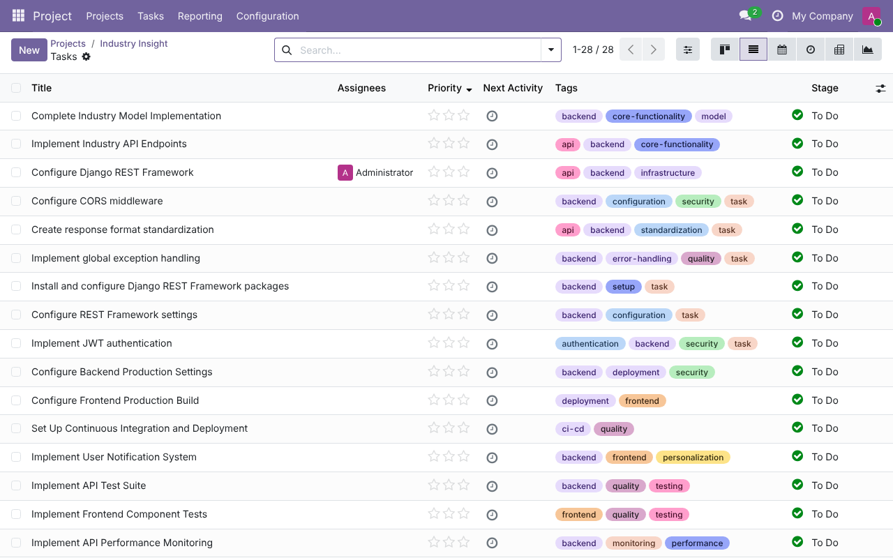
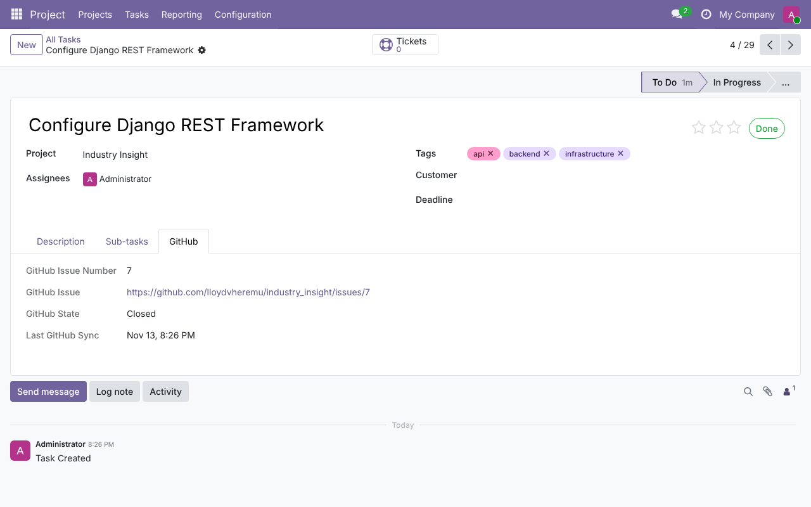

To link a project to a repository:

1.  Open a project (*Project \> Projects*, then the project's settings).
    You must be a Project administrator.
2.  Open the *GitHub* tab, enter the repository as `owner/name` and tick
    *Sync with GitHub*.

    

3.  Click *Sync now*, or wait for the hourly scheduled action
    *Project: Sync GitHub issues*. A notification shows how many tasks
    were created and updated.
4.  The issues are now tasks of the project, with their labels as tags.
    Here all the issues of the repository are closed, so every task is
    *Done*:

    

5.  Open a task and use its *GitHub* tab to see the issue number, a link
    to the issue, its state and the time of the last sync. Issue 7 is
    assigned to the GitHub account set as the *GitHub Login* of the
    Administrator:

    

Running the sync again never creates duplicates, even if a task was
archived. If GitHub returns an error (bad token, rate limit, repository
not found, timeout), it is posted in the project's chatter and the last
sync time is not advanced, so the next run fetches the same issues again.

The screenshots show a test database with the public repository
`lloydvheremu/industry_insight`.
